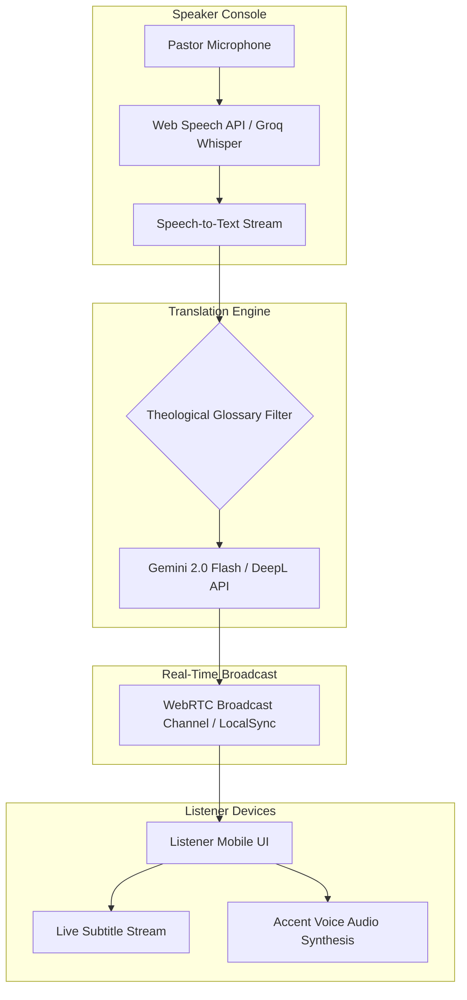

# SermonTranslator 🎙️🌐

**SermonTranslator** is a low-cost, low-latency web application designed for real-time sermon transcription, translation, and live subtitle broadcasting to congregants' mobile devices.

Tailored specifically for churches, ministries, and bilingual congregations, it translates live spoken sermons (e.g. Spanish audio input) into real-time translated subtitles (e.g. English) and headphone voice playback with zero mandatory cloud operational cost ($0.00/month).

---

## 🌟 Key Features

- **Zero-Cost Architecture ($0.00 / month):** Leverages browser-native Web Speech API + Google Gemini 2.0 Flash / 1.5 Flash Free Tier + Web Speech Synthesis.
- **Spanish-to-English & Multi-Language Support:** Optimized for Spanish spoken audio input with instant English subtitle output, plus support for 10+ target languages (Portuguese, French, Haitian Creole, Korean, Tagalog, Chinese, etc.).
- **AI Model Selection:** Switch between translation engines:
  - ✨ **Gemini 2.0 Flash / 1.5 Flash** (Theological AI pre-promoted for biblical context)
  - 🌐 **DeepL Translate API** (High linguistic fluency)
  - 🧠 **OpenAI GPT-4o-mini**
  - ⚡ **Offline Native Dictionary**
- **Theological System Prompting:** Auto-corrects and preserves biblical terminology (*Gospel* $\rightarrow$ *Evangelio*, *Grace* $\rightarrow$ *Gracia*, *Psalms*, *Leviticus*).
- **Dual Dashboard Views:**
  - 🎙️ **Pastor / Speaker View:** Live microphone controls, real-time audio visualizer canvas, transcript blocks, QR code join generator, custom glossary manager, and TXT/SRT subtitle export options.
  - 📱 **Congregation Listener View:** Mobile-optimized teleprompter display, customizable font sizes (A-, A, A+), color themes (Dark, Warm Reading, Light, High Contrast), and headphone read-aloud TTS.
- **Realtime Accent Voice Models:** Support for natural accent voice personas (Gemini Multimodal Live API, ElevenLabs Spanish Accent, or Native Speech Engine).
- **Interactive Cost Calculator:** Embedded slider tool to compare monthly costs across sermon duration and congregation size.

---

## 🏗️ Architecture Overview



---

## 🚀 Quick Start & Local Setup

No build step or complex setup required! The app is built with native HTML5, CSS3, and JavaScript ES6.

1. **Clone the repository:**
   ```bash
   git clone https://github.com/tenken127/SermonTranslator.git
   cd SermonTranslator
   ```

2. **Serve locally using Python or any HTTP server:**
   ```bash
   python3 -m http.server 8080
   ```

3. **Open in browser:**
   Navigate to `http://localhost:8080` to launch the Pastor Dashboard and Listener View.

---

## 📄 Documentation & PRD

For full product requirements, cost comparison matrices, and technical specs, see [`SermonTranslatorPRD.md`](./SermonTranslatorPRD.md).

---

## 📜 License

MIT License. Free for all churches, ministries, and non-profit organizations.
