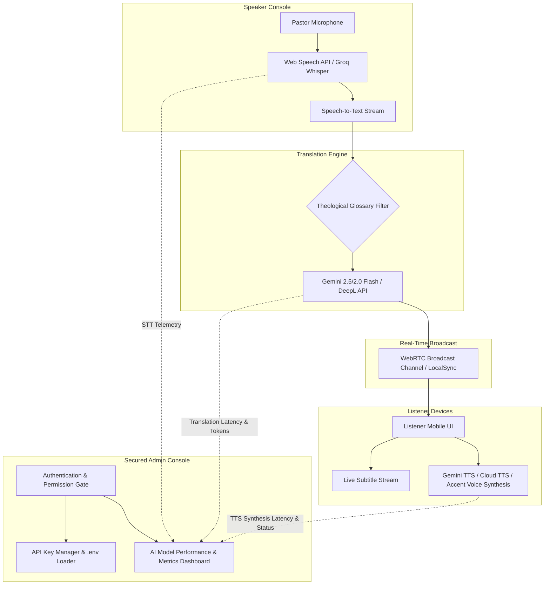

# SermonTranslator 🎙️🌐

**Current Specification Version:** `v2.0` (Updated `2026-11-11`)

**SermonTranslator** is a low-cost, low-latency web application designed for real-time sermon transcription, translation, and live subtitle broadcasting to congregants' mobile devices.

Tailored specifically for churches, ministries, and bilingual congregations, it translates live spoken sermons (e.g. Spanish audio input) into real-time translated subtitles (e.g. English) and headphone voice playback with zero mandatory cloud operational cost ($0.00/month).

---

## 🌟 Key Features

- **Zero-Cost Architecture ($0.00 / month):** Leverages browser-native Web Speech API + Google Gemini 2.0 Flash / 1.5 Flash Free Tier + Web Speech Synthesis.
- **Spanish-to-English & Multi-Language Support:** Optimized for Spanish spoken audio input with instant English subtitle output, plus support for 10+ target languages (Portuguese, French, Haitian Creole, Korean, Tagalog, Chinese, etc.).
- **AI Model Selection:** Switch between translation engines:
  - ✨ **Gemini 2.5 / 2.0 / 1.5 Flash** (Theological AI pre-prompted for biblical context)
  - 🌐 **DeepL Translate API** (High linguistic fluency)
  - 🧠 **OpenAI GPT-4o-mini**
  - ⚡ **Offline Native Dictionary**
- **Theological System Prompting:** Auto-corrects and preserves biblical terminology (*Gospel* $\rightarrow$ *Evangelio*, *Grace* $\rightarrow$ *Gracia*, *Psalms*, *Leviticus*).
- **Multi-Role Views & Secured Admin Console:**
  - 🎙️ **Pastor / Speaker View:** Live microphone controls, real-time audio visualizer canvas, transcript blocks, QR code join generator, custom glossary manager, and TXT/SRT subtitle export options.
  - 📱 **Congregation Listener View:** Mobile-optimized teleprompter display, customizable font sizes (A-, A, A+), color themes (Dark, Warm Reading, Light, High Contrast), and headphone read-aloud TTS with live voice testing.
  - 🔐 **Authenticated Admin View (`#view-admin`):** Locked-by-default administration console requiring authentication to secure role permissions, manage multi-provider API keys (Google Gemini, Groq, DeepL, ElevenLabs, OpenAI), enforce session inactivity timeouts, and run live connection/TTS tests.
- **AI Model Performance & Metrics Dashboard (Admin View):**
  - Real-time and session telemetry tracking STT, Translation, and TTS latency (`Last`, `Avg`, `p50`, `p95` ms), Requests Per Minute (RPM), token/character consumption, API success vs. fallback rates, theological glossary hit rate, and side-by-side model performance benchmarks.
- **Realtime Accent Voice Models & Live TTS Synthesis:** Support for natural accent voice personas (`Kore`, `Charon`, `Puck`, `Aoede`, `Fenrir`) powered by Google Gemini 2.5 Flash TTS (`gemini-2.5-flash-preview-tts`), Google Cloud Neural2 TTS, ElevenLabs Spanish Accent, or Native Browser Speech Engine.
- **Strict `.env` Secret & PII Isolation:** API keys are stored exclusively in `.env` (gitignored) or encrypted browser storage—never hardcoded in `app.js`, `index.html`, or auxiliary source files.
- **Interactive Cost Calculator:** Embedded slider tool to compare monthly costs across sermon duration and congregation size.

---

## 🏗️ Architecture Overview



---

## 🚀 Quick Start & Local Setup

No build step or complex setup required! The app is built with native HTML5, CSS3, and JavaScript ES6.

1. **Clone the repository:**
   ```bash
   git clone <repository-url>
   cd SermonTranslator
   ```

2. **Configure API keys in `.env` (Optional for Cloud AI / Live TTS):**
   - Place your provider API keys strictly in `.env` at the project root (`GEMINI_API_KEY`, `GROQ_API_KEY`, `DEEPL_API_KEY`, `ELEVENLABS_API_KEY`, `OPENAI_API_KEY`, `ADMIN_PIN`).
   - **Security Rule:** Never place API keys or personally identifiable information (PII) in `app.js`, `index.html`, or any file other than `.env`.

3. **Serve locally using Python or any HTTP server:**
   ```bash
   python3 -m http.server 8080
   ```

4. **Open in browser:**
   Navigate to `http://localhost:8080` to launch the Pastor Dashboard, Audience View, and Authenticated Admin Console.

---

## 📋 Version Control & Requirements Changelog

| Version | Date | Tracked Requirement & Architecture Changes |
| :--- | :--- | :--- |
| **v1.0** | 2026-09-27 | Initial release with real-time browser STT, multi-language theological translation, Speaker & Listener views, and Cost Calculator. |
| **v1.1** | 2026-09-29 | Added Admin View (`#view-admin`) for multi-provider API key configuration, client-side key obfuscation, and connection testing. |
| **v1.2** | 2026-11-10 | Added live Google Gemini 2.5 Flash TTS (`gemini-2.5-flash-preview-tts`) & Google Cloud Neural2 TTS synthesis, selectable voice personas, interactive TTS testing UI, and strict `.env`-only secret isolation. |
| **v2.0** | 2026-11-11 | Added mandatory **Admin View Authentication & Permission Security** (locked-by-default access gate, RBAC permissions, inactivity auto-lock, failed-attempt throttling) and **AI Model Performance & Metrics Dashboard** requirements in Admin View. |

---

## 📄 Documentation & PRD

For full product requirements, cost comparison matrices, security specifications, and AI telemetry metrics specs, see [`SermonTranslatorPRD.md`](./SermonTranslatorPRD.md).

---

## 📜 License

MIT License. Free for all churches, ministries, and non-profit organizations.
