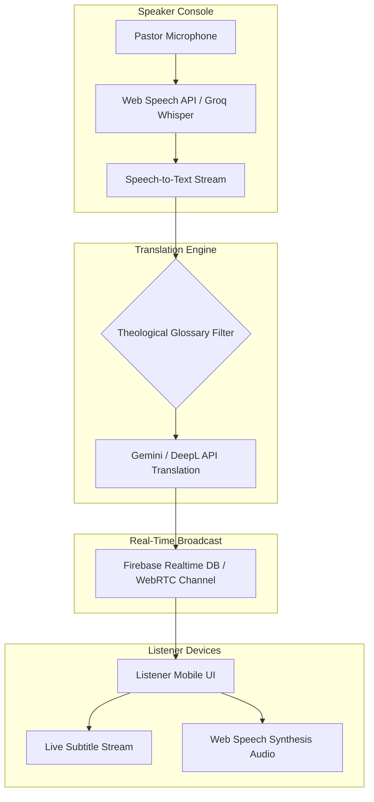

# Product Requirements Document (PRD): Sermon Translator Web Application

## 1. Executive Summary
**Sermon Translator** is a low-latency, high-accuracy web-based real-time transcription and translation system tailored specifically for churches and religious organizations. It allows pastors and speakers to deliver sermons in their native language while instantly broadcasting real-time translated subtitles and synthesized audio to congregants' smartphones, tablets, or sanctuary displays.

This document outlines the product requirements, low-cost architectural approaches, pricing breakdown, and feature specs.

---

## 2. Lowest-Cost Architectural Approach

To achieve the lowest total cost of ownership (TCO)—ranging from **$0.00/month** for small-to-medium congregations up to **<$5.00/month** for large churches—we leverage client-side browser capabilities combined with free-tier AI APIs.

### Cost Matrix & Comparison

| Tier | Component | Technology / Service | Pricing Structure | Monthly Cost (4 Sermons/mo) |
| :--- | :--- | :--- | :--- | :--- |
| **Tier 0: 100% Free** | Speech-to-Text | Web Speech API (`webkitSpeechRecognition`) | 100% Free (Native Browser Engine) | **$0.00** |
| | Translation | Gemini 2.0 Flash / 1.5 Flash Free Tier | 15 RPM / 1M tokens/day free | **$0.00** |
| | Broadcasting | PeerJS (WebRTC) / BroadcastChannel / Local Storage | Free & Peer-to-Peer | **$0.00** |
| | Listener TTS | Web Speech Synthesis API | Native Browser Engine | **$0.00** |
| | Hosting | Vercel / GitHub Pages / Cloudflare Pages | Free Tier with SSL | **$0.00** |
| **Total Tier 0 Cost** | | | | **$0.00 / month** |

| Tier | Component | Technology / Service | Pricing Structure | Monthly Cost (4 Sermons/mo) |
| :--- | :--- | :--- | :--- | :--- |
| **Tier 1: Hybrid High-Accuracy** | Speech-to-Text | Groq Whisper API (`whisper-large-v3-turbo`) | $0.04 / hour of audio | ~$0.16 |
| | Translation | Gemini 1.5 Flash API | $0.075 / 1M tokens | ~$0.02 |
| | Live Data Sync | Firebase Realtime DB (Spark Plan) | Free up to 100 concurrent users & 10GB/mo | $0.00 |
| | Hosting | Cloudflare Pages / Vercel | Free Tier | $0.00 |
| **Total Tier 1 Cost** | | | | **~$0.18 / month** |

---

## 3. Key User Roles & Workflows

### 3.1 Pastor / Speaker (Broadcast Host)
*   **Goal:** Focus on sermon delivery in native language (e.g. Spanish) without tech distractions.
*   **Workflow:**
    1. Opens the Speaker Dashboard on laptop/tablet.
    2. Selects input microphone and primary spoken language (e.g., **Spanish** `es-ES / es-MX`).
    3. Selects primary target translation output (e.g., **English** `en-US` or other target languages).
    4. Clicks "Start Live Sermon Broadcast".
    5. Generates a QR Code / Short Room URL for the congregation.
    6. Views real-time transcript stream with pause/resume and quick correction capabilities.

### 3.2 Audience / Congregation Listener
*   **Goal:** Read or listen to the sermon live in English (or their native language) on their mobile device.
*   **Workflow:**
    1. Scans QR Code or enters 4-digit room code on mobile web browser (no app download required).
    2. Selects desired target language (e.g., **English**, Spanish, Portuguese, French, Haitian Creole, Korean, Tagalog).
    3. Views real-time scrolling subtitles with adjustable font sizes.
    4. Optionally toggles "Audio Headphone Mode" (Text-to-Speech) for spoken translated audio.

---

## 4. Feature Requirements & Functional Specs

### 4.1 Speech Recognition & Audio Processing
- **Real-Time Streaming:** Sub-second latency audio-to-text processing.
- **Theological Jargon & Bible Dictionary:** Custom keyword boosting for biblical names (e.g., Leviticus, Nebuchadnezzar, Ecclesiastes, Resurrection, Grace) to ensure high transcription accuracy.
- **Audio Meter Visualizer:** Real-time microphone input volume indicator.

### 4.2 Multi-Language Translation
- **Supported Languages:** Spanish, Portuguese, French, Haitian Creole, Chinese (Simplified/Traditional), Korean, Tagalog, Vietnamese, Russian, Ukrainian, German, Italian, Arabic, Japanese, Hindi.
- **Contextual Theological Translation:** Preserves scriptural context (e.g., translating "Gospel" as "Evangelio" in religious context).

### 4.3 AI Model & Engine Selection (Translation & STT Quality Controls)
To maximize translation accuracy for complex sermons, biblical metaphors, and theological terms, the platform allows pastors/administrators to select their preferred Speech-to-Text and Translation AI engines:

#### Translation Model Options:
1. **Gemini 2.0 Flash / 1.5 Flash (Recommended - Free Tier):**
   - **Cost:** $0.00 (15 Requests/Min, 1M tokens/day free).
   - **Strengths:** Excellent theological understanding, high speed (~200ms latency), handles scripture verse context.
2. **DeepL API (Free / Pro):**
   - **Cost:** Free up to 500,000 characters/mo, then $5.49/mo + usage.
   - **Strengths:** Highest natural language fluency and grammatical precision for European and Asian languages.
3. **Gemini 1.5 Pro / Claude 3.5 Sonnet / GPT-4o:**
   - **Cost:** Pay-per-token API usage.
   - **Strengths:** Unrivaled deep theological nuance, archaic bible translation alignment (KJV/NIV equivalents).
4. **Browser Native / Offline Rules Engine:**
   - **Cost:** $0.00.
   - **Strengths:** Zero-latency, works completely offline without API keys.

#### Realtime Accent Voice & Audio Synthesis Options:
To broadcast spoken translations over headphones to congregants with natural, human-like voice inflection and accent controls (similar to ChatGPT Realtime Voice):

1. **Gemini Multimodal Live API (Gemini 2.0 Flash - WebSocket Bidirectional Audio):**
   - **Cost:** ~$0.05 - $0.15 per hour of audio streaming (or Free Tier quota).
   - **Capabilities:** Direct audio-in to audio-out streaming via WebSockets. Supports native accent voices (e.g. Spanish-accented English, warm pastoral English, expressive cadence), custom voice instructions, sub-300ms latency, and live speech interruption.
2. **OpenAI Realtime API (`gpt-4o-realtime-preview`):**
   - **Cost:** ~$18.00 / hour of audio ($0.06/min in, $0.24/min out).
   - **Capabilities:** Ultra-realistic voice models (Alloy, Echo, Shimmer), highly expressive, but substantially higher operational cost for churches.
3. **ElevenLabs Conversational Voice API / Custom Accent Cloning:**
   - **Cost:** ~$0.15 / 1,000 characters (~$1.50/hr).
   - **Capabilities:** Industry gold-standard voice cloning (can clone the pastor's actual voice!), precise accent matching, and natural emotional delivery.
4. **Browser Native Web Speech Synthesis (TTS):**
   - **Cost:** $0.00.
   - **Capabilities:** Zero-cost, client-side browser speech engines (Siri/Google voices with language/voice pitch adjustment).

### 4.5 Audience Experience & Accessibility
- **Zero App Download:** Web-based PWA accessible on iOS Safari, Android Chrome, and desktop browsers.
- **Customizable Display:**
  - Font scaling (Small, Medium, Large, Extra Large).
  - High-contrast themes (Dark Glass, High Contrast Black, Warm Reading, Light Modern).
  - Auto-scroll to latest translation with manual lock override.
- **Accent Voice Read-Aloud (TTS):** Choice of AI Realtime Voice engine (Gemini Multimodal Live, ElevenLabs Accent Voice, or Browser Native) for translated audio over headphones.

### 4.6 Data Export & Archiving
- Export complete sermon transcript and translations in formatted TXT or Subtitle (`.srt`) files for video re-broadcasting.

---

## 5. System Architecture Diagram

---

## 6. Implementation Roadmap

- **Phase 1 (Working Demo - Completed):** Single-page web application featuring live browser STT, instant multi-language translation, Speaker View, Listener UI with QR code sharing, font controls, TTS audio synthesis, and an interactive cost calculator.
- **Phase 2 (MVP):** Integration with Groq Whisper API for noisier room environments and Firebase Realtime DB for multi-device network syncing.
- **Phase 3 (Production):** Custom domain setup, church logo branding options, SRT subtitle export, and automated sermon summary generation.
